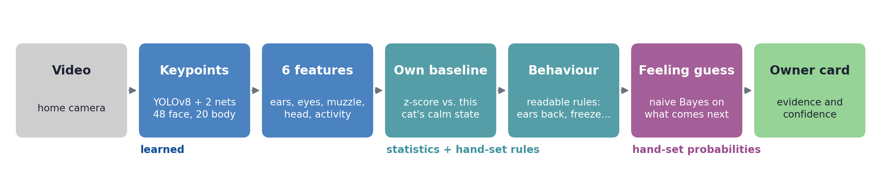
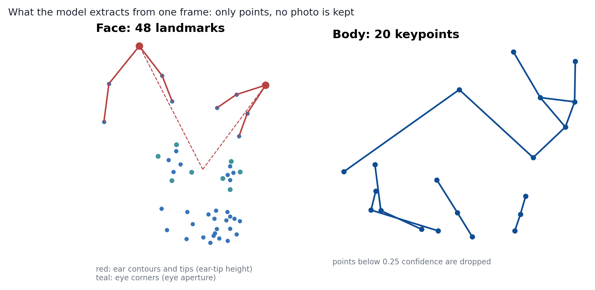
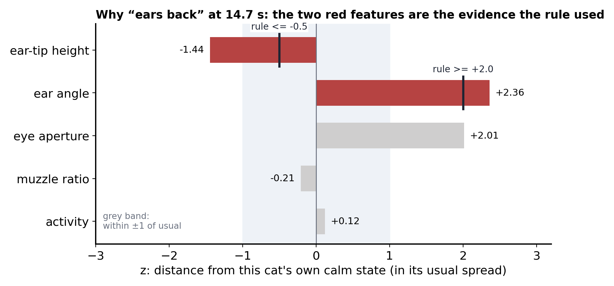
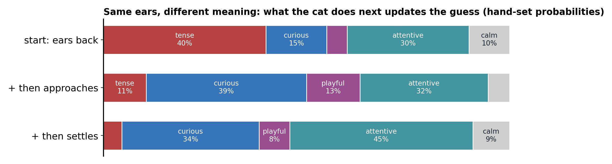
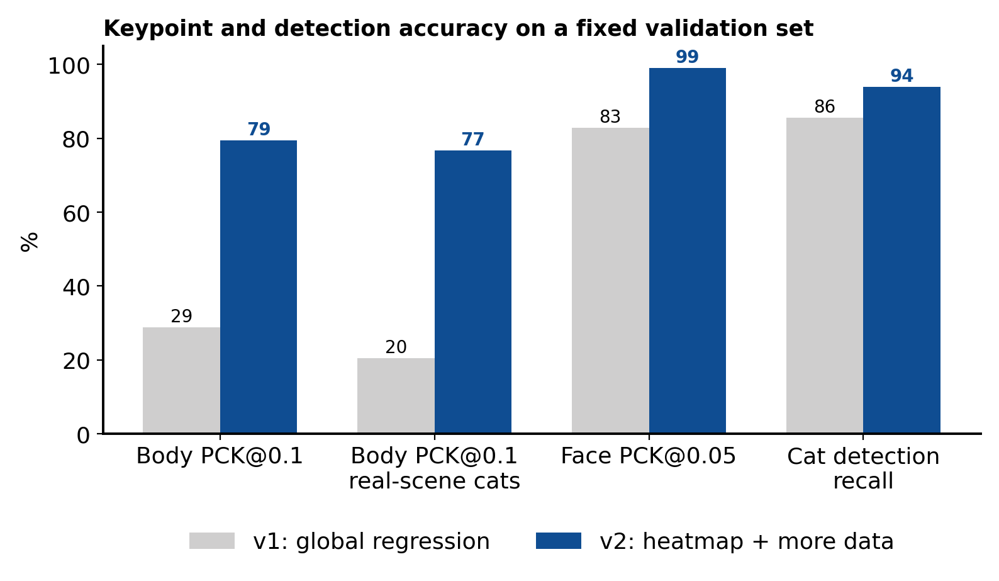

[English](README.md) | **中文**

# 读懂猫的脸和身体，并说出依据

这个项目从普通的家庭视频里，给猫的脸标出 48 个点、身体标出 20 个点，把耳朵、眼睛和动作和**这只猫自己平静时的样子**比较，再把变化变成行为标签和对情绪的推测。每个推测都附上依据、把握程度和另一种可能。

它来自 TU/e 课程项目 *AI Interactive Robot for Cats*。本仓库是其中的识别和解释部分；测试时机器人由人遥控，没有接到识别程序上。



## 怎么做的

**1. 用点，不用像素。** 检测器找到猫，两个小网络标出脸部 48 个点和身体 20 个点，每个点带一个把握值。把握低于 0.25 的点不用，看不清的帧就记为“看不清”，不硬凑数字。



**2. 和猫自己比。** 从点里算出六个特征：耳尖高度、耳朵角度、眼睛开合度、口鼻比、头部下垂和活动量。折耳猫的耳朵天生就低，所以每个特征都换算成相对这只猫平静基线的 z 值：偏离了平时多少个“正常抖动”。

**3. 用读得懂的规则得到行为。** “耳朵后压”“警觉”“僵住”“活跃”来自几条针对 z 值的“如果……就……”规则。规则记下哪个特征越过了哪个门槛，主人看到的就是这份记录。



**4. 接下来做什么，决定情绪推测。** 耳朵压平可能是害怕，也可能是专注。系统先按行为给五种状态一个起点，再看随后 5 秒猫做了什么（离开、逃开、靠近、扑玩、平静、不动），用朴素贝叶斯更新。把握不够时不给情绪，只写看到的行为。



**5. 解释经过检验。** 每个事件都用同一份规则重跑：把写出的依据改回“平时”，标签必须改变；把没写出的特征改回平时，标签必须不变。在一段 37.9 分钟、一只银猫和一只黑猫的测试里，62 个事件全部通过。两只猫按毛色区分。

## 结果



| 指标 | v1 | v2（当前） |
| --- | --- | --- |
| 身体 PCK@0.1（150 个猫实例） | 28.7% | 79.4% |
| 脸 NME（207 张，越低越好） | 3.62% | 1.21% |
| 猫检测召回率（132 张） | 85.6% | 93.9% |
| 实时流水线（Apple M5 Pro） | 4–5 FPS | 约 30 FPS |

## 哪些是测过的，哪些是假设

| 部分 | 状态 |
| --- | --- |
| 检测与关键点 | 在公开数据集上训练和评估 |
| 特征、基线、行为规则 | 在真实视频上运行；阈值是手设的 |
| 情绪推测（五种状态） | 概率手设，**没有用人工标注验证** |
| 解释 | 做过忠实度检验：卡片写的就是规则实际用到的条件 |

系统不识别情绪。它报告猫的脸和身体发生了什么变化，以及这个变化可能意味着什么。验证集同时用于挑选模型，验证图是照片，不是家用摄像头画面。

## 快速开始

```bash
python3 -m venv ml/.venv
ml/.venv/bin/pip install -r requirements.txt

# 解释层测试
cd ml && PYTHONPATH=. .venv/bin/python tests/test_explanations.py && cd ..

# 分析一段视频，生成带片段和依据的主人报告
PYTHONPATH=ml ml/.venv/bin/python -m catpose.realtime --source clip.mp4 --detect --report-dir reports/clip --no-display

# 摄像头实时分析
PYTHONPATH=ml ml/.venv/bin/python -m catpose.realtime --source 0 --detect --report-dir sessions/live1

# 两只猫：先学毛色，再每次只跟一只
PYTHONPATH=ml ml/.venv/bin/python -m catpose.identity discover videos/ --out sessions/cats.json
PYTHONPATH=ml ml/.venv/bin/python -m catpose.realtime --source clip.mp4 --detect --cats sessions/cats.json --cat dark --report-dir reports/dark
```

YOLOv8 检测器权重第一次运行时由 Ultralytics 自动下载。

## 仓库内容

| 目录 | 内容 |
| --- | --- |
| `ml/catpose/` | 检测、关键点、特征、规则、贝叶斯推断、忠实度检验、主人报告、实时与多机位分析、区分猫 |
| `ml/checkpoints/` | 训练好的关键点权重 `body.pt`、`face.pt` |
| `ml/tests/` | 解释层测试 |
| `ml/docs/` | 架构、API、快速开始、训练（英文） |
| `ml/colab/` | Colab 理论教程（需要另外的数据包，含数据集图片） |
| `ml/*.md` | 中文文档：训练报告、运行说明、参考文献 |
| `hardware/` | 机器人网桥固件和 Arduino UNO Q 板端应用，留作参考，没有接到识别程序上 |
| [`docs/analysis.zh.md`](docs/analysis.zh.md) | Colab 教程、学习网站和主人 App 的对比分析 |

上面的图都由一段 36 秒网络视频的关键点和事件数字画成，不含视频画面。仓库里没有训练数据集、测试录像和数据集图片。

## 一步步看

[案例实验室](https://xai-fieldnotes.vercel.app/case) 用一段猫的视频走完每一步，[模型图解](https://xai-fieldnotes.vercel.app/model) 用 3D 展示整个模型。

## 许可

代码和文档使用 MIT 许可（[LICENSE](LICENSE)）。权重不属于 MIT：`face.pt` 用 CatFLW 训练（CC BY-NC 4.0，仅限非商业用途），`body.pt` 用 Animal Pose 和 PASCAL VOC 训练，YOLOv8 检测器是 AGPL-3.0。详见 [THIRD_PARTY_NOTICES.md](THIRD_PARTY_NOTICES.md)。
