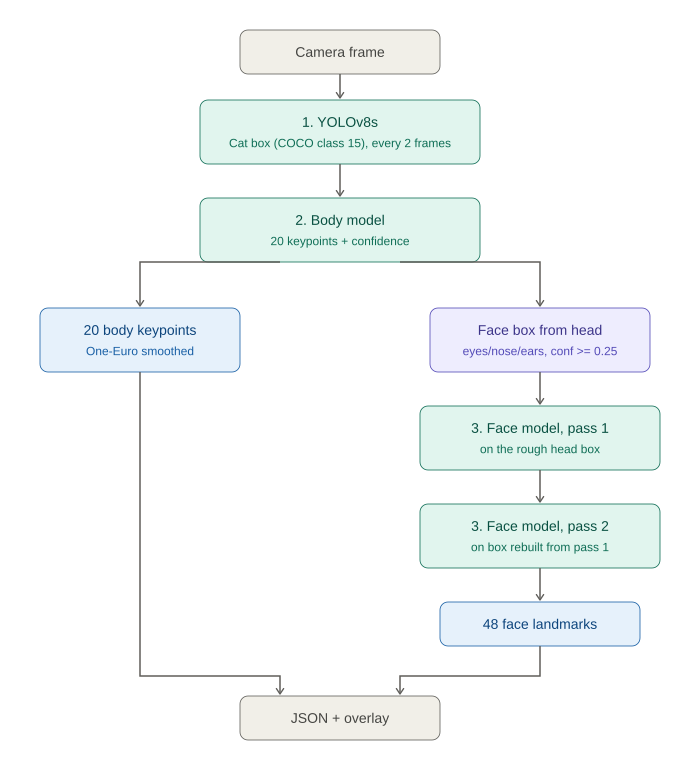
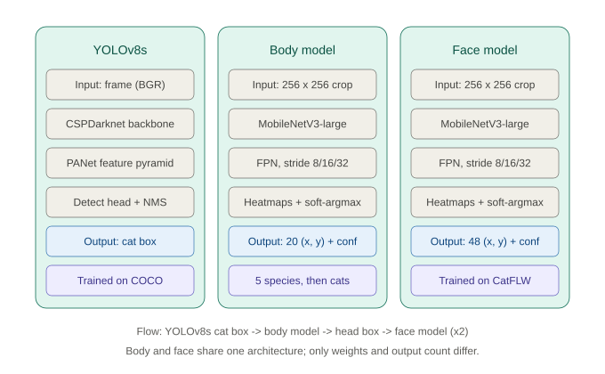
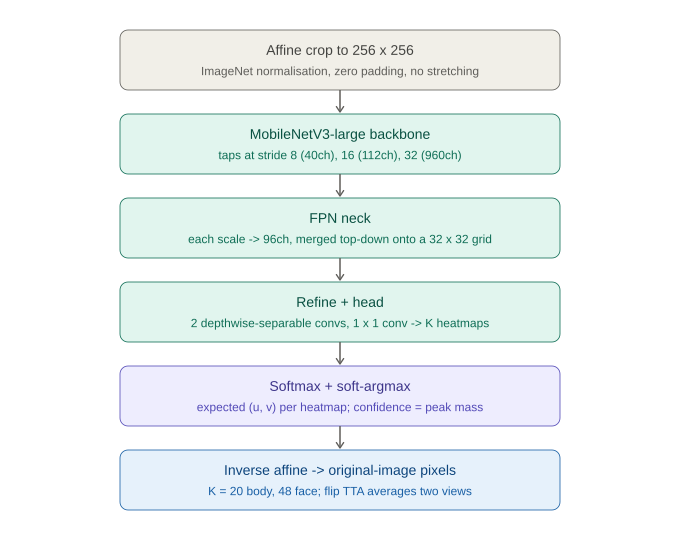

# Architecture (v2)

Three networks run in sequence on each frame. The order is fixed because each
stage's output decides the next stage's input.

## 1. The three networks

| Network | Role | Structure | Trained on |
|---|---|---|---|
| **YOLOv8s** | Find the cat | CSPDarknet backbone + PANet neck + detect head + NMS | COCO (pretrained, not retrained; only class 15 "cat" is used) |
| **Body model** | 20 skeleton keypoints | MobileNetV3-large + FPN + heatmap head | Animal Pose, 5 species pretrain → cat fine-tune |
| **Face model** | 48 facial landmarks | Same architecture | CatFLW |

## 2. Per-frame flow

1. **Detect.** YOLOv8s returns the highest-confidence cat box. Frames are
   passed as BGR (Ultralytics' convention for numpy input). YOLO runs every 2
   frames; the last box is reused for up to 15 frames if the cat is briefly
   missed.
2. **Body.** The box is expanded 15%, squared, and affine-warped to 256×256
   (zero-padded past the frame edge, never stretched). The model returns 20
   points plus a confidence for each. With flip TTA, the mirrored patch is
   also predicted and averaged after swapping left/right keypoints.
3. **Face box.** The body's head points (eyes, nose, ears) with confidence ≥
   0.25 are enclosed and padded 55%. If fewer than 3 are confident (cat
   facing away), the face model is skipped.
4. **Face, pass 1.** 48 landmarks on that rough box.
5. **Face, pass 2.** A CatFLW-style box is rebuilt from the pass-1 landmarks
   (extent × 1.36 wide, × 1.30 tall, centre 3% lower) and the face model runs
   again. This removes the error caused by a rough box (NME 1.58% → 1.19%).
6. **Smooth.** A One-Euro filter per point stream reduces jitter while the cat
   is still, and follows quickly when it moves.
7. **Output.** JSON with box, points and confidences, plus an overlay image.
   Points below the confidence threshold are not drawn.

## 3. Inside a landmark model

- **Input:** 256×256 RGB patch, ImageNet mean/std normalisation.
- **Backbone:** MobileNetV3-large (ImageNet pretrained). Features are tapped at
  three scales: stride 8 (40 ch), stride 16 (112 ch), stride 32 (960 ch).
- **Neck:** lightweight FPN. Each scale is projected to 96 channels and merged
  top-down onto the stride-8 grid, then refined by two depthwise-separable
  convolutions.
- **Head:** 1×1 convolution to K heatmaps of 32×32 (K = 20 body, 48 face).
- **Decoding:** softmax over each heatmap, then the probability-weighted mean
  position (soft-argmax / integral regression). This is differentiable and
  sub-cell accurate.
- **Confidence:** probability mass in the 3×3 cells around the peak.
- **Loss:** L1 between predicted and true coordinates (in heatmap-cell units)
  + KL divergence to a Gaussian target (σ = 1.5 cells), masked by keypoint
  visibility.

### Why this replaced v1

v1 used MobileNetV3-small → global average pool → MLP → coordinates. The
pooling step collapses the 7×7 spatial grid into one vector, so the network
no longer knows *where* in the image anything is and has to memorise
positions. With the same 180 training images, switching to the heatmap design
plus augmentation alone raised body PCK@0.1 from 28.7% to 59.0%.

## 4. Extension points (not implemented)

- **XAI:** Grad-CAM on the backbone, or the heatmaps themselves, show which
  pixels drive each keypoint. No retraining needed.
- **Emotion:** feed keypoint sequences into (1) geometric rules based on the
  Feline Grimace Scale, (2) XGBoost on angle/distance features, or (3) a
  TCN / ST-GCN once labelled clips exist. References in
  [参考文献与技术说明.md](../参考文献与技术说明.md).
