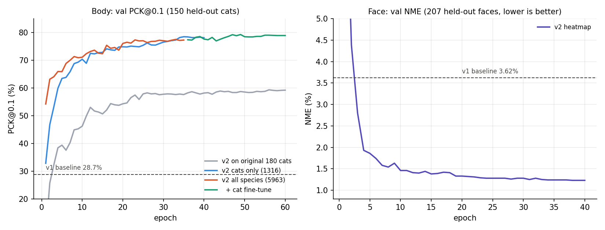

# CatPose v2 训练报告

日期：2026-09-24　·　硬件：Apple M5 Pro（MPS GPU 训练与推理）　·　代码：`ml/catpose/`

## 一句话结论

身体关键点在真实场景猫图上的准确率（PCK@0.1）从 **28.7% 提升到 79.4%**，脸部关键点误差（NME）从 **3.62% 降到 1.21%**，检测器漏检减少近 60%，整条实时流水线从 **4–5 FPS 提升到约 30 FPS**。

| 指标 | v1（上一版） | v2（本版） |
|---|---|---|
| 身体 PCK@0.1（150 只验证猫） | 28.7% | **79.4%** |
| 身体 PCK@0.1（其中真实场景 VOC 猫） | 20.5% | **76.7%** |
| 脸部 NME（207 张验证脸） | 3.62% | **1.21%** |
| 脸部 PCK@0.05 | 82.8% | **99.0%** |
| 猫检测召回率（132 张验证图） | 85.6% | **93.9%** |
| 实时流水线（M5 Pro） | ~4–5 FPS | **~30 FPS** |

---

## 1. 为什么要做这一轮

上一版在摄像头里点位乱飘。这次先建立正式评估，定位到三个根因：

1. **身体模型泛化失败。** 在和训练集相似的 20 张图上 PCK@0.1 有 70.7%，在真实场景的 VOC 猫图上只有 **20.5%**。原因是训练数据只有 180 张，且模型结构丢失了空间信息（见第 3 节）。
2. **脸部模型本身不差（NME 3.62%），但它的输入框依赖身体模型的头部点**。身体模型猜错头，脸就跟着错。
3. **检测器有一个通道顺序 bug**：Ultralytics 把 numpy 输入当作 BGR，而我们传的是 RGB。一张测试帧上猫的置信度因此从 0.85 掉到 0.14，被判定为"沙发"。

## 2. 评估方法

- **固定验证集**（写入 `ml/splits/splits.json`，所有实验共用）：
  - 脸：CatFLW 207 张（与 v1 的验证集相同）。
  - 身体：150 个猫实例 = v1 的 20 个验证实例 + 新增 VOC 猫图按图片随机抽 10%（130 个）。同一张图上的其他动物实例全部排除出训练集，避免泄漏。
- **指标**：
  - **PCK@α**：预测点离真值的距离小于 α × 框的长边，就算"命中"。报告 α = 0.05（严格）和 0.1（常用）。越高越好。
  - **NME**：平均误差 ÷ √(框宽 × 框高)。越低越好。
- 评估时用**真值框**裁剪，衡量的是关键点模型本身，不受检测器影响。检测器单独评估召回率。
- 评估脚本：`python -m catpose.evaluate --kind body --ckpt ml/checkpoints/body.pt`

## 3. 做了哪些改动

### 3.1 模型架构：全局回归 → 热力图

| | v1 | v2 |
|---|---|---|
| 骨干 | MobileNetV3-small | MobileNetV3-large（ImageNet 预训练） |
| 头部 | 全局平均池化 → MLP → 直接输出坐标 | 轻量 FPN 融合 1/8、1/16、1/32 三层特征 → 每个关键点一张 32×32 热力图 → soft-argmax 取期望位置 |
| 输入 | 224×224 | 256×256 |
| 损失 | Smooth L1 + MSE | 坐标 L1（热力图格子单位）+ 高斯目标 KL 正则 |
| 每点置信度 | 无 | 有（峰值附近 3×3 概率质量） |

v1 在全局池化这一步把 7×7 的空间网格压成一个向量，**"关键点在图里的哪个位置"这一信息在这里被丢掉了**，只能靠 MLP 硬记。热力图头保留空间网格，是 HRNet、RTMPose 等主流关键点模型的做法。置信度让界面可以隐藏不确定的点，也让脸框只由可信的头部点推出。

### 3.2 数据

- 下载 PASCAL VOC 2012（1.9 GB，只解出 Animal Pose 用到的 3608 张，约 414 MB，原包已删除）。
- 身体训练数据：**180 → 1316 只猫**；另有狗 1771、羊 1078、马 960、牛 842 个实例，与猫共用同一套 20 点定义，用于预训练，合计 **5963** 个实例。
- 脸部数据不变（CatFLW 1872 训练 / 207 验证）。

### 3.3 数据增强

| | v1 | v2 |
|---|---|---|
| 裁剪 | 框随机外扩 | 随机缩放 0.8–1.25、平移 ±8%、**旋转 ±30°** |
| 翻转 | 仅身体 | 身体 + **脸**（见下） |
| 颜色 | 无 | 亮度 / 对比度 / 饱和度、偶尔灰度、偶尔模糊 |
| 越界处理 | 框被截断后拉伸，猫会**变形** | 仿射变换 + 黑边补齐，**不变形** |

**脸部左右对称映射**：CatFLW 没有公布 48 个点的左右对应关系，所以之前不能做水平翻转。本次用平均脸形与其镜像做匈牙利匹配自动推导，得到一个严格自逆的映射（4 个中线点映射到自身，平均匹配误差 0.3%），并用可视化逐张核对过。

（增强样本检查图含数据集照片，未随仓库公开。）

### 3.4 训练流程

- 身体分两阶段：先在 5 种动物上训 35 轮，再只用猫微调 25 轮（学习率 3e-4）。
- 脸：40 轮。
- 优化器 AdamW，余弦学习率 + 预热，按验证集选最优轮次（身体按 PCK@0.1，脸按 NME，因为脸的 PCK@0.1 已饱和在 99.9%）。
- 全部在 MPS 上训练：脸约 15 秒/轮，身体全物种约 40 秒/轮，微调约 6 秒/轮。**总计约 40 分钟**。



### 3.5 推理端

- **两遍脸部精修**：第一遍在头部点推出的粗框上预测，第二遍用第一遍的 48 个点按 CatFLW 标注规律（点外接框 × 1.36 / 1.30）重建标准脸框再预测一次。
- **测试时翻转增强（TTA）**：原图和镜像各推理一次再平均，GPU 上只多约 5 ms。
- **置信度门控**：置信度 < 0.25 的点不画；头部可信点不足 3 个时不跑脸部模型，而不是在错误位置画 48 个点。
- **One-Euro 时序滤波**：静止时强平滑去抖，快速运动时降低平滑减少拖影。
- **检测器**：修复 RGB/BGR bug，默认换成 YOLOv8s。
- 推理默认使用 Apple GPU（MPS）。

## 4. 实验结果

### 4.1 身体关键点（150 个验证猫实例，1649 个可见点）

| 模型 | 训练数据 | PCK@0.05 | PCK@0.1 | NME | 真实场景 VOC PCK@0.1 |
|---|---|---|---|---|---|
| v1 全局回归 | 180 只猫 | 10.6 | 28.7 | 24.6% | 20.5 |
| v2 热力图 | 180 只猫（同 v1） | 38.8 | 59.0 | 15.0% | 52.6 |
| v2 热力图 | 1316 只猫 | 56.1 | 78.4 | 8.7% | 75.6 |
| v2 热力图 | 5963 个多物种实例 | 57.5 | 77.8 | 8.5% | 74.8 |
| **v2 多物种 → 猫微调（采用）** | **5963 → 1316** | **58.0** | **79.4** | **8.3%** | **76.7** |

（v2 各行均含翻转 TTA。）

**提升来自哪里（消融）：**

| 改动 | PCK@0.1 变化 |
|---|---|
| 新架构 + 新增强（数据不变） | 28.7 → 59.0，**+30.3** |
| 数据 180 → 1316 只猫 | 59.0 → 78.4，**+19.4** |
| 多物种预训练 + 猫微调 | 78.4 → 79.4，+1.0 |

多物种预训练让前期收敛明显加快（第 2 轮 63% vs 47%），但最终只多约 1 个点，在误差范围附近。

**分部位（PCK@0.1）：**

| 部位 | v1 | v2 |
|---|---|---|
| 头部（眼、鼻、耳） | 37% | **91%** |
| 肘 | 25% | 64% |
| 膝 | 19% | 70% |
| 爪 | 19% | 71% |
| 喉 / 肩胛 / 尾根 | 30% | 78% |

头部点的提升最关键：脸框完全由它们推出。

（v1 与 v2 的对比图含数据集照片，未随仓库公开。）

*绿线 = 预测点在 10% 范围内，红线 = 超出，线的另一端是真值。第三行仰躺倒置的猫：v1 对 1/13，v2 对 11/13，主要得益于旋转增强。*

### 4.2 脸部关键点（207 张验证脸，9936 个点）

| 模型 | PCK@0.05 | PCK@0.1 | NME |
|---|---|---|---|
| v1 全局回归 | 82.8 | 96.1 | 3.62% |
| v2 热力图 | 99.0 | 99.9 | 1.23% |
| **v2 + 翻转 TTA（采用）** | **99.0** | **99.9** | **1.21%** |

**脸框质量对结果的影响**（模拟实时场景：把真值框随机缩放 0.7–1.6 倍、平移 ±20%）：

| 设置 | NME |
|---|---|
| 真值框，1 遍 | 1.21% |
| 粗糙框，1 遍 | 1.58% |
| **粗糙框，2 遍（采用）** | **1.19%** |
| 粗糙框，3 遍 | 1.20% |

第二遍完全抵消了粗框带来的损失，第三遍没有额外收益。

### 4.3 猫检测器（132 张验证图，召回率）

| 设置 | 召回率 |
|---|---|
| YOLOv8n，传 RGB（v1 的 bug） | 85.6% |
| YOLOv8n，修复为 BGR | 90.2% |
| **YOLOv8s，BGR（采用）** | **93.9%** |

置信度阈值从 0.20 降到 0.15 对召回率没有影响，保持 0.20。

### 4.4 速度（M5 Pro，单帧 640×480）

| 组件 | MPS（GPU） | CPU |
|---|---|---|
| YOLOv8n | 9.1 ms | 22.9 ms |
| YOLOv8s | 10.7 ms | 42.4 ms |
| 身体模型（含 TTA） | 8.0 ms | 214 ms |
| 脸部模型（含 TTA，每遍） | 8.7 ms | 227 ms |
| **整条流水线**（YOLO 隔帧 + 身体 + 脸 2 遍） | **约 31 ms ≈ 30 FPS** | 约 700 ms |

## 5. 需要如实说明的局限

1. **没有独立测试集。** 最优轮次是在验证集上挑的，报告的数字也来自同一验证集，因此略偏乐观。差距在 1–2 个点以内的结论（例如多物种预训练的 +1.0）不应视为确定结论。
2. **验证图是照片，不是摄像头画面。** VOC 图片的光照、角度、分辨率与网络摄像头不同，实际效果需要在摄像头里再确认。
3. **腿和爪仍是弱项**（64–71%），尤其是蜷缩、趴卧和互相遮挡的姿势。
4. **纯 CPU 机器上 v2 很慢**（关键点模型每次约 200 ms）。没有 Apple GPU 或 NVIDIA GPU 的组员需要关闭 TTA，或者后续训练一个 MobileNetV3-small 版本。
5. **之前发给组员的分享包里是 v1 模型**，需要重新打包才能拿到本次改进。
6. 置信度阈值（0.25）和脸框外扩系数是经验值，没有系统调参。

## 6. 下一步建议

按预期收益排序：

1. **在摄像头画面上做一次实测**，确认验证集结论在真实使用中成立，并收集失败帧。
2. **收集并标注 100–200 帧自家摄像头的失败帧**加入训练。这是针对部署场景最有效的数据。
3. **腿部专项**：输入分辨率从 256 提到 320，或骨干换成更大的模型（ConvNeXt-Tiny），代价是速度。
4. **给纯 CPU 机器训练一个 MobileNetV3-small 版本**，并重新打包分享。
5. **划出独立测试集**，让后续改进的结论更可靠。

## 7. 如何复现

```bash
cd catpose-robot   # 仓库根目录

# 身体：多物种预训练 → 猫微调
PYTHONPATH=ml ml/.venv/bin/python -m catpose.train_hm --kind body --species all --epochs 35 --out body_all.pt
PYTHONPATH=ml ml/.venv/bin/python -m catpose.train_hm --kind body --species cat --epochs 25 --lr 3e-4 \
    --init ml/checkpoints/exp/body_all.pt --out body_ft.pt

# 脸
PYTHONPATH=ml ml/.venv/bin/python -m catpose.train_hm --kind face --epochs 40 --out face_hm.pt

# 评估
PYTHONPATH=ml ml/.venv/bin/python -m catpose.evaluate --kind body --ckpt ml/checkpoints/exp/body_ft.pt
PYTHONPATH=ml ml/.venv/bin/python -m catpose.evaluate --kind face --ckpt ml/checkpoints/exp/face_hm.pt
```

## 附录：文件

| 文件 | 说明 |
|---|---|
| `ml/checkpoints/body.pt`、`face.pt` | 当前默认模型（v2） |
| `ml/checkpoints/body_v1.pt`、`face_v1.pt` | 上一版备份，可随时回退 |
| `ml/checkpoints/yolov8s.pt` | 默认检测器（`yolov8n.pt` 仍保留） |
| `ml/checkpoints/exp/` | 全部实验权重及每轮指标（`*.history.json`） |
| `ml/logs/` | 训练日志、最终评估结果（`final_eval.json`）、速度测试 |
| `ml/splits/splits.json` | 固定验证集划分 |
| `ml/catpose/samples.py` | 数据加载与划分 |
| `ml/catpose/transforms.py` | 仿射裁剪与增强 |
| `ml/catpose/heatmap_model.py` | v2 网络结构与损失 |
| `ml/catpose/train_hm.py` | v2 训练脚本 |
| `ml/catpose/evaluate.py` | 评估脚本 |
| `ml/catpose/smoothing.py` | One-Euro 时序滤波 |
| `ml/scripts/face_refine_experiment.py` | 脸框两遍精修实验 |
